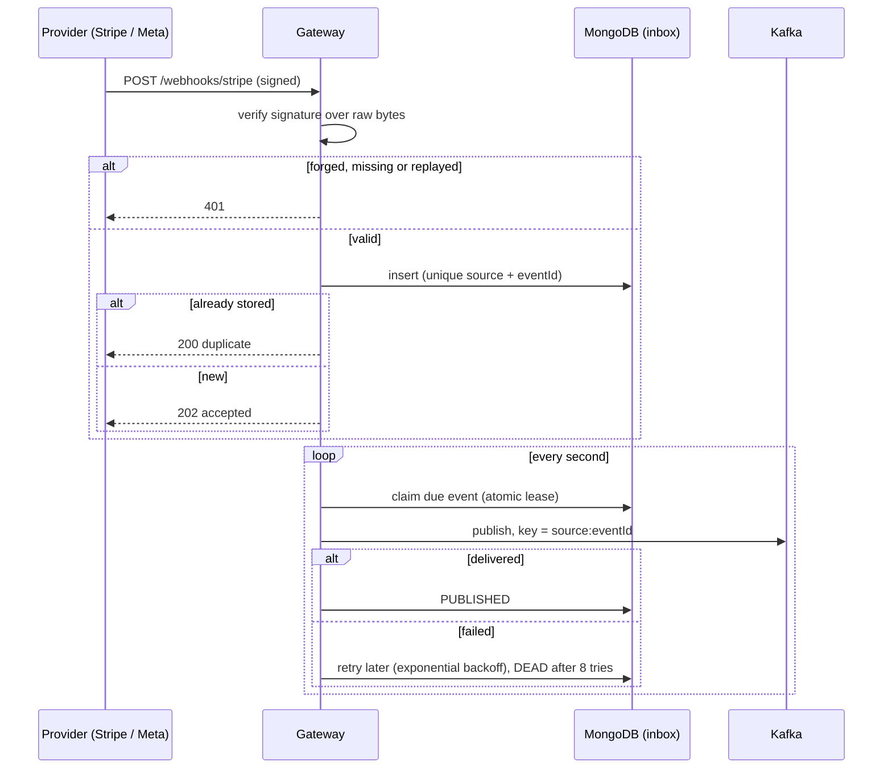

# Integration Gateway

[](https://github.com/coldworld22/integration-gateway/actions/workflows/ci.yml)


[](LICENSE)

One front door for third-party webhooks. It checks that each request really comes from the provider, stores it exactly once, and delivers it to Kafka even when Kafka is down, so the systems behind it (ERP, billing, notifications) consume clean events instead of each one handling signatures, retries and duplicates on its own.

It grew out of the integrations I've built for payments (Stripe, PayPal) and the WhatsApp Business Cloud API, where the same problems came up every time: forged requests, providers retrying the same event, and events lost when a downstream system was briefly unavailable.

## How it works



## Features

- **Signature verification** for Stripe (`Stripe-Signature`, HMAC-SHA256 over `timestamp.body`) and Meta / WhatsApp Cloud API (`X-Hub-Signature-256`). Checked over the **raw request bytes** with constant-time comparison. Stripe timestamps older than 5 minutes are refused, so a captured request can't be replayed, and several signatures are accepted during secret rotation.
- **Idempotent inbox in MongoDB:** a unique index on `(source, eventId)` turns provider retries into a `200 duplicate` instead of a second event, even when two copies arrive at the same instant on two instances.
- **Transactional outbox to Kafka:** the webhook is acknowledged as soon as it's stored. Delivery happens afterwards, so a Kafka outage delays events but never loses them.
- **Safe with several instances:** each instance claims events with an atomic `findAndModify` lease, so the same event isn't published twice in parallel.
- **Retries with exponential backoff** (5 s, 10 s, 20 s and so on, capped at an hour). After 8 failures an event is parked as `DEAD` with its last error.
- **Operator API** to list dead events and replay them, protected by an admin token and turned off when no token is set.
- **The WhatsApp verification handshake** (`hub.challenge`) for registering the webhook with Meta.
- **Prometheus metrics** for events received (accepted or duplicate), published and dead, per source, plus health probes.

## Event format

Messages on `integration.events.v1` are keyed `source:eventId`, so all copies of one event go to the same partition and consumers can deduplicate on the key:

```json
{
  "id": "6737a1c2e4b0a1b2c3d4e5f6",
  "source": "stripe",
  "eventId": "evt_1Q7…",
  "eventType": "payment_intent.succeeded",
  "receivedAt": "2026-11-15T20:07:01.512Z",
  "payload": { "...": "the provider's original JSON" }
}
```

## Run it locally

You need Docker.

```bash
cp .env.example .env
docker compose up --build
```

This starts MongoDB, a single-node Kafka (KRaft, no ZooKeeper) and the gateway on http://localhost:8080.

### Send a signed test event

```bash
SECRET=whsec_local_dev_secret            # same as STRIPE_WEBHOOK_SECRET in .env
BODY='{"id":"evt_demo_1","type":"payment_intent.succeeded","data":{"object":{"amount":5000}}}'
T=$(date +%s)
SIG=$(printf '%s' "$T.$BODY" | openssl dgst -sha256 -hmac "$SECRET" -hex | sed 's/^.* //')

curl -i http://localhost:8080/webhooks/stripe \
  -H "Stripe-Signature: t=$T,v1=$SIG" -H 'Content-Type: application/json' -d "$BODY"
# 202 {"status":"accepted"}; send it again and you get 200 {"status":"duplicate"}

docker compose exec kafka /opt/kafka/bin/kafka-console-consumer.sh \
  --bootstrap-server localhost:9092 --topic integration.events.v1 --from-beginning --property print.key=true
```

### Operator endpoints

```bash
curl -H "X-Admin-Token: change-me" "http://localhost:8080/admin/events?status=DEAD"
curl -X POST -H "X-Admin-Token: change-me" http://localhost:8080/admin/events/<id>/replay
```

## Consuming events safely

Delivery is at-least-once, so every consumer must treat a repeated message as a no-op. [`IdempotentPaymentConsumer`](src/main/java/io/github/coldworld22/gateway/example/IdempotentPaymentConsumer.java) shows the pattern with Stripe payments:

- **The dedupe key lives with the data.** Each payment is stored with the message key (`stripe:evt_…`) under a unique index. A second copy of the message hits the index and is skipped. There's no separate "processed messages" table that could be updated without the payment, or the other way round.
- **Money is stored in minor units** (halalas, cents) as integers, exactly as Stripe sends it. No floating point.
- **Failures don't block the queue.** A transient error is retried twice; then the message moves to `integration.events.v1.DLT` with the exception in its headers. A message that can't be parsed goes there immediately, because retrying won't fix it.

Tests prove it: the same message sent twice gives one payment, a Stripe webhook retried end to end gives one payment, other event types are ignored, and a malformed message lands on the dead-letter topic.

Run it with `EXAMPLE_CONSUMER_ENABLED=true`. In a real system this consumer would be its own service with its own database; it lives here to keep the example in one place.

## API

| Method | Path | What |
|---|---|---|
| `POST` | `/webhooks/stripe` | Stripe events, verified with `STRIPE_WEBHOOK_SECRET` |
| `GET` | `/webhooks/whatsapp` | Meta's subscription handshake, checked against `META_VERIFY_TOKEN` |
| `POST` | `/webhooks/whatsapp` | WhatsApp Cloud API events, verified with `META_APP_SECRET` |
| `GET` | `/admin/events?status=DEAD` | List events by status (needs `X-Admin-Token`) |
| `POST` | `/admin/events/{id}/replay` | Requeue a dead event (needs `X-Admin-Token`) |
| `GET` | `/actuator/prometheus` | Metrics |

## Tests

```bash
mvn verify
```

Unit tests cover both signature schemes (valid, tampered, replayed, malformed, rotated secrets) and the backoff schedule. The integration tests start **real MongoDB and Kafka with Testcontainers** and check the full path: a signed event reaches Kafka exactly once even when sent twice, forged requests store nothing, the WhatsApp handshake works, and a dead event can be replayed by an operator.

## Design decisions

- **Why acknowledge before publishing?** Providers expect a fast 2xx and retry anything slower. Writing to MongoDB is the commit point; once stored, the event survives restarts and Kafka outages. Publishing in the request would tie the provider's success to Kafka's availability.
- **Why at-least-once and not exactly-once?** If the gateway crashes after Kafka accepted a message but before marking it published, it will send it again. Exactly-once across MongoDB and Kafka would need distributed transactions, so instead every message carries a stable key and consumers deduplicate on it. That's the standard trade-off.
- **Why a lease instead of a lock?** `findAndModify` moves `nextAttemptAt` forward atomically, which claims the event. If the instance dies mid-delivery, the lease simply expires and another instance picks the event up. No lock to clean up.
- **Why hash the WhatsApp body for the event ID?** A WhatsApp webhook can carry several messages and status updates with no single ID. Meta retries with an identical body, so a SHA-256 of the body identifies one delivery exactly.
- **Why does a duplicate get 200, not 409?** The provider did nothing wrong. Any 4xx would make it retry or flag the endpoint as failing.
- **Why not log why a signature failed in the response?** The reason (expired, wrong secret, malformed) is logged for operators but the caller only sees "Invalid signature", so a forger learns nothing.

## Adding a provider

Add a verifier next to `StripeSignatureVerifier`, an endpoint in `WebhookController` that extracts the provider's event ID, and the secret to `GatewayProperties`. PayPal is the natural next one; its signatures are verified by calling PayPal's verification API, so it would also need an HTTP client with a timeout and its own retry policy.

## License

MIT
